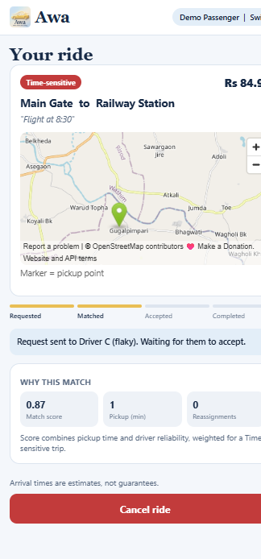
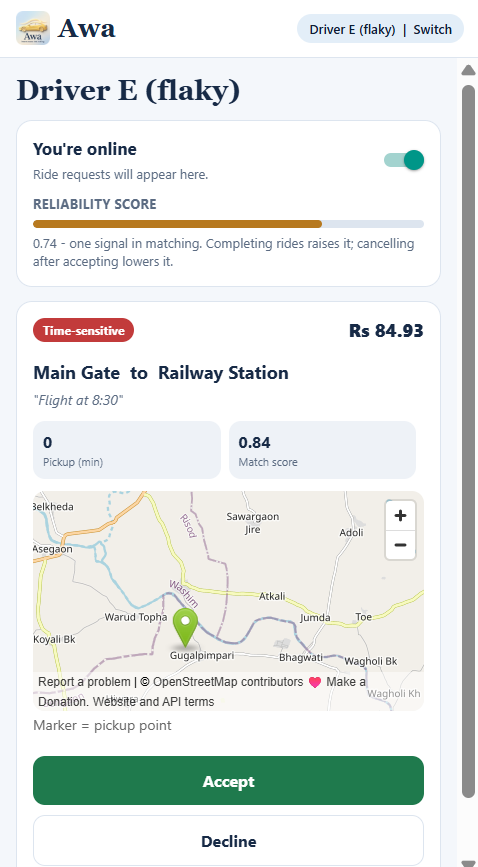
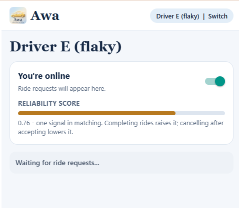
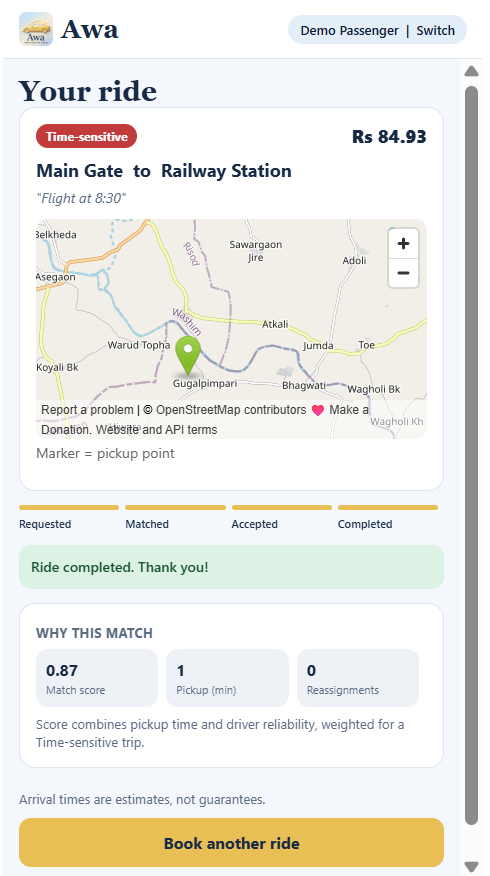
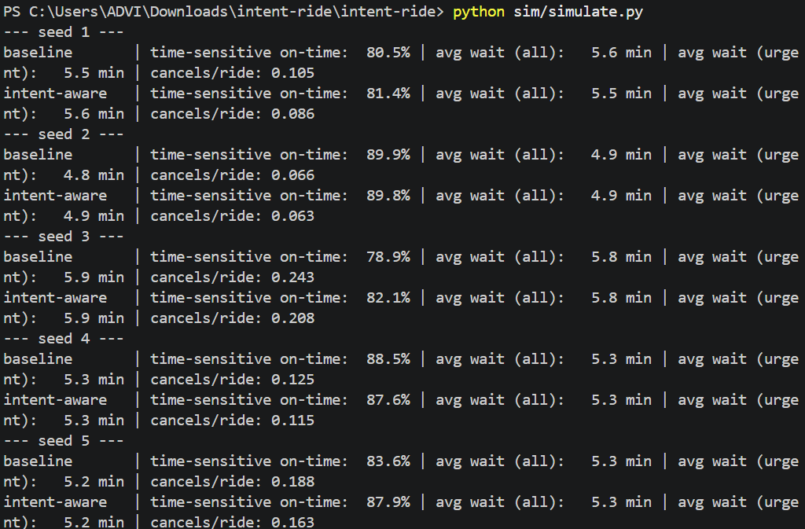

# Awa: Intent-Aware Ride-Hailing
**Live demo:** https://awa-intent-aware-ride-hailing-app.vercel.app

**Demo video:** https://youtu.be/FyWpxRpVyDE

> The backend runs on a free server that sleeps when idle, so the first load can take about 50 seconds. To try it, open two browser windows: one as the passenger and one as the driver the ride is offered to.
Most ride apps treat every booking the same. **Awa** lets a passenger say how much a trip matters
(*Flexible*, *Important* or *Time-sensitive*) and uses that, together with each driver's reliability,
to pick the driver. If the driver cancels after accepting, the **same booking** is re-matched
automatically and the passenger is told what is happening.

> Hackathon prototype. Matching is rule-based and the "drivers" are simulated.

## Screenshots











## Features
- Passenger intent: Flexible / Important / Time-sensitive, with an optional 80-character reason.
- Intent-aware matching: score = pickup time, driver reliability, urgency compatibility, with different weights per intent.
- Reliability score with a neutral starting value for new drivers, a recent-behaviour window, and no permanent bans.
- Cancel-and-reassign: a driver cancel is recorded, the same ride is offered to the next best driver, and the passenger sees it live.
- Anti-gaming: after 3 Time-sensitive requests in 24 h, further ones are treated as Important.
- Live updates (Supabase Realtime plus polling fallback), admin stats endpoint, and a simulation comparing against nearest-driver matching.

## Tech stack
| Layer | Tool |
|---|---|
| App (web and phone) | Expo (React Native, TypeScript) |
| Backend | FastAPI (Python) |
| Database, realtime | Supabase (PostgreSQL) |
| Maps | OpenStreetMap (web), react-native-maps (phone) |

## Project structure
```
backend/   FastAPI service: matching.py, reliability.py, db.py, main.py, schema.sql
app/       Expo app (screens in app/src)
sim/       simulate.py: baseline vs intent-aware comparison (no database needed)
```

## Run it locally
**1. Database.** Create a free Supabase project, open SQL Editor, run `backend/schema.sql`.

**2. Backend**
```
cd backend
python -m venv .venv
.venv\Scripts\activate            # macOS/Linux: source .venv/bin/activate
pip install -r requirements.txt
copy .env.example .env            # then fill in SUPABASE_URL and SUPABASE_SERVICE_KEY
uvicorn main:app --reload --port 8000
```
API docs: http://localhost:8000/docs

**3. App**
```
cd app
npm install
copy .env.example .env            # API URL plus the Supabase publishable key (never the secret key)
npx expo start --web
```
Open one window as the passenger and another as a driver.

## Simulation results (assumption-based)
`python sim/simulate.py` compares nearest-driver matching with the intent-aware score on 3,000 simulated
rides per seed (8 drivers with hidden cancellation rates, 30% Time-sensitive, 9-minute target window,
6-minute penalty per cancellation). Averages over 5 seeds:

| Metric | Nearest driver | Intent-aware |
|---|---|---|
| Time-sensitive rides on time | 84.3% | 85.8% |
| Driver cancellations per ride | 0.145 | 0.127 |

These numbers come from a simulation with assumed parameters, not real riders. They show the direction of the
effect, not production performance. The weights in `backend/matching.py` are tunable.

## Limitations and next steps
- Simulated drivers and straight-line distances; no real road network or live GPS.
- Demo login only; no real authentication. Row Level Security is minimal and should be tightened before real use.
- Next: real auth, driver location updates, an admin dashboard, and tuning weights on real data.
